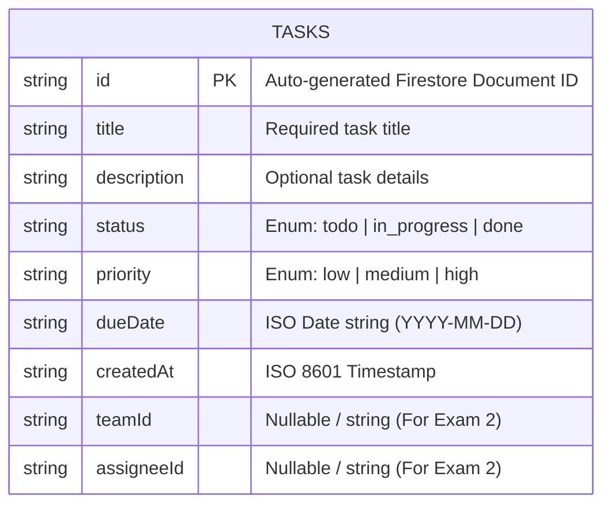

# TaskFlow – Task Management Mobile App (React Native & Firebase Firestore)

> **MMA301 – Practical Exam 1 Submission**  
> Technical foundation of a mobile Task Management application built with **React Native (Expo)**, **TypeScript**, and **Cloud Firestore Database**.

---

## 📱 Features

- **Project Scaffolding**: Built using React Native with Expo (TypeScript template) with clean modular folder architecture (`src/components`, `src/screens`, `src/services`, `src/hooks`, `src/theme`, `src/types`, `src/utils`).
- **Cloud Firestore Database**: Connected to Firebase Cloud Firestore for real-time document storage.
- **Real-time Synchronization**: Uses Firestore `onSnapshot` listener to reactively update the UI when tasks are created, edited, or deleted across clients.
- **Full Task CRUD**:
  - **Create Task**: Interactive modal form with title, description, priority selector, status picker, and due date.
  - **Read Tasks**: Categorized list with responsive cards, priority color bars, and status indicators.
  - **Update Task**: Pre-filled modal form allowing updates to title, description, status, priority, and due dates.
  - **Delete Task**: Safety confirmation dialog before permanent deletion.
  - **Quick Status Toggle**: Tap status pill on any card to cycle between `To Do` -> `In Progress` -> `Completed`.
- **Bonus Capabilities**:
  - **Client-side Form Validation**: Real-time error messages (e.g. required title check).
  - **Multi-criteria Filtering**: Filter by Status (`All`, `To Do`, `In Progress`, `Completed`), Priority (`High`, `Medium`, `Low`), and keyword search.
  - **Pull-to-Refresh**: Native `RefreshControl` integration.
  - **Placeholder Navigation**: Bottom Tab Navigator with `Home`, `Teams` (Practical Exam 2 preview), and `Profile` tabs.
  - **CI/CD Pipeline**: GitHub Actions workflow (`.github/workflows/ci.yml`) validating ESLint and TypeScript on every commit.

---

## 🗄️ Firestore Data Model & ERD Schema

Each task document is stored in the `tasks` Firestore collection:



### Document Fields Reference

| Field | Type | Description | Required | Exam Stage |
|---|---|---|---|---|
| `id` | `string` | Auto-generated Firestore Document ID | Yes | Exam 1 |
| `title` | `string` | Task title / summary | Yes | Exam 1 |
| `description` | `string` | Detailed notes / task requirements | No | Exam 1 |
| `status` | `'todo' \| 'in_progress' \| 'done'` | Current completion state | Yes | Exam 1 |
| `priority` | `'low' \| 'medium' \| 'high'` | Priority level | Yes | Exam 1 |
| `dueDate` | `string` | Due date string (`YYYY-MM-DD`) | Yes | Exam 1 |
| `createdAt` | `string` | Creation ISO timestamp | Yes | Exam 1 |
| `teamId` | `string \| null` | Team workspace reference | No | Exam 2 |
| `assigneeId` | `string \| null` | Assigned member ID | No | Exam 2 |

---

## 🛠️ Tech Stack

- **Framework**: [React Native](https://reactnative.dev/) (v0.86) with [Expo SDK 57](https://expo.dev/)
- **Language**: [TypeScript](https://www.typescriptlang.org/) (Strict mode)
- **Backend / Database**: [Firebase Cloud Firestore](https://firebase.google.com/docs/firestore)
- **Navigation**: [@react-navigation/bottom-tabs](https://reactnavigation.org/)
- **Icons**: [@expo/vector-icons (Ionicons)](https://icons.expo.fyi/)
- **Code Quality**: ESLint v10 + Prettier + TypeScript Compiler (`tsc --noEmit`)
- **CI / CD**: GitHub Actions

---

## 🚀 Getting Started

### 1. Prerequisites
- Node.js (v18+ or v20+ recommended)
- npm or bun
- Expo Go app on mobile device or Android/iOS emulator

### 2. Installation
```bash
# Clone the repository
git clone <YOUR_GITHUB_REPO_URL>
cd TaskManagementApp

# Install dependencies
npm install
```

### 3. Firebase Configuration
1. Create a Firebase Project at [Firebase Console](https://console.firebase.google.com/).
2. Create a Cloud Firestore database in **Test Mode**.
3. Register a Web App in Firebase Project Settings to obtain your API configuration keys.
4. Copy `.env.example` to `.env`:
   ```bash
   cp .env.example .env
   ```
5. Fill in your Firebase keys in `.env`:
   ```env
   EXPO_PUBLIC_FIREBASE_API_KEY=AIzaSy...
   EXPO_PUBLIC_FIREBASE_AUTH_DOMAIN=your-app.firebaseapp.com
   EXPO_PUBLIC_FIREBASE_PROJECT_ID=your-project-id
   EXPO_PUBLIC_FIREBASE_STORAGE_BUCKET=your-app.appspot.com
   EXPO_PUBLIC_FIREBASE_MESSAGING_SENDER_ID=123456789012
   EXPO_PUBLIC_FIREBASE_APP_ID=1:123456789012:web:...
   ```
*(Note: If `.env` is omitted, the app automatically runs in graceful demo in-memory storage mode without crashing).*

### 4. Running the Application
```bash
# Start Metro bundler
npx expo start

# Run on Web directly
npx expo start --web

# Run on Android Emulator
npx expo start --android

# Run on iOS Simulator
npx expo start --ios
```

### 5. Quality Checks
```bash
# Check TypeScript types
npm run typecheck

# Run ESLint
npm run lint

# Format code
npm run format
```

---

## 📂 Project Structure

```
├── .github/
│   └── workflows/
│       └── ci.yml               # GitHub Actions CI pipeline
├── assets/                      # Application icons & splash assets
├── src/
│   ├── components/
│   │   ├── DeleteConfirmModal.tsx # Task deletion confirmation dialog
│   │   ├── EmptyState.tsx       # Zero-state illustration and action
│   │   ├── FilterBar.tsx        # Search input and status/priority filter chips
│   │   ├── Header.tsx           # Branding, subtitle, and live stats overview
│   │   ├── TaskCard.tsx         # Task item card with actions & status toggle
│   │   └── TaskModal.tsx        # Create/Edit Task form modal with validation
│   ├── hooks/
│   │   └── useTasks.ts          # State management & Firestore real-time hook
│   ├── navigation/
│   │   └── AppNavigator.tsx     # Bottom tab navigation (Home, Teams, Profile)
│   ├── screens/
│   │   ├── HomeScreen.tsx       # Main Task management screen
│   │   ├── ProfileScreen.tsx    # User profile placeholder screen
│   │   └── TeamsScreen.tsx      # Teams & collaboration placeholder screen
│   ├── services/
│   │   ├── firebase.ts          # Firebase SDK & Firestore initialization
│   │   ├── firebaseConfig.example.ts # Example config file
│   │   └── taskService.ts       # Firestore CRUD logic (subscribe, add, update, delete)
│   ├── theme/
│   │   ├── colors.ts            # Design system palette
│   │   ├── index.ts             # Theme exports
│   │   ├── spacing.ts           # Spacing, border radius & elevation
│   │   └── typography.ts        # Typography tokens
│   ├── types/
│   │   └── task.ts              # TypeScript interfaces & types
│   └── utils/
│       └── dateUtils.ts         # Date formatting & overdue calculation helpers
├── .env.example                 # Environment variables template
├── .gitignore                   # Ignored files (node_modules, .env, .expo)
├── .prettierrc                  # Prettier code formatting rules
├── App.tsx                      # Root component with NavigationContainer
├── app.json                     # Expo configuration
├── eslint.config.mjs            # ESLint flat configuration
├── package.json                 # Project dependencies & scripts
└── tsconfig.json                # TypeScript compiler configuration
```

---

## 📝 License
This project is prepared for MMA301 Practical Exam 1.
