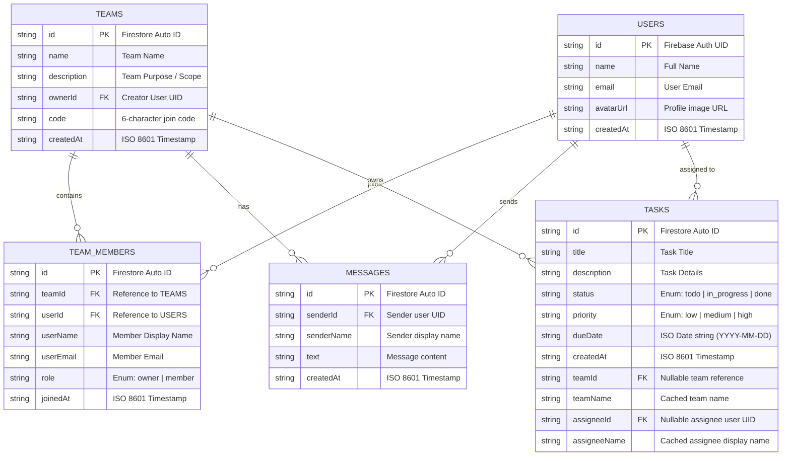

# TaskFlow – Task & Team Management Mobile App (React Native & Firebase)

> **MMA301 – Practical Exam 2 Submission**  
> Complete collaborative task management mobile application with **Firebase Authentication**, **Team Workspaces & Roles**, **Task Assignments**, and **Real-Time Team Chat** powered by **Cloud Firestore**.

---

## 📱 Features (Practical Exam 2)

### 1. 🔐 Firebase Authentication & Protected Navigation
- **Sign Up**: Full registration form (`name`, `email`, `password`, `confirmPassword`) creating a Firebase Auth user and a linked document in the `users` Firestore collection (`id`, `name`, `email`, `avatarUrl`, `createdAt`).
- **Sign In**: Secure authentication via email & password with contextual validation and Firebase error handling.
- **Persistent Auth**: Session persists across app restarts using `onAuthStateChanged` and `@react-native-async-storage/async-storage`.
- **Auth-Aware Navigation**: Automatic routing between `AuthStack` (`Login`, `SignUp`) and `AppStack` (`Home`, `Teams`, `Profile`, `TeamDetail`, `Chat`).
- **Profile & Logout**: Dedicated Profile screen showing user credentials, student metadata, and secure sign-out.

### 2. 👥 Teams & Workspaces
- **Create Teams**: Generate workspaces with name, description, and an auto-generated 6-character join code (e.g. `AB12CD`).
- **Join Teams**: Join existing teams instantly by entering the 6-character team code.
- **Team Detail Screen**:
  - Displays team metadata and join code.
  - Lists all team members with roles (`Owner` vs `Member`) and avatar initials.
  - Lists tasks filtered for the team.
  - Direct CTA button to launch the team's real-time chat.

### 3. 📋 Tasks with Teams & Assignees
- **Assign to Teams**: Select any of the user's teams or assign as Personal task.
- **Assign to Members**: Dynamically loads team members in `TaskModal` for assigning to a specific teammate.
- **Rich Task Cards**: Shows Priority pill, Status pill, Due date, **Team Name tag**, and **Assignee Name tag**.
- **Real-time Task Synchronization**: Uses Firestore `onSnapshot` to sync updates instantly across devices.

### 4. 💬 Real-Time Team Chat
- **Per-team Subcollection**: Chat messages stored under `teams/{teamId}/messages`.
- **Real-time `onSnapshot` Listener**: Automatically scrolls and reflects incoming messages without manual refresh.
- **Visual Bubble Distinction**:
  - Current user messages: Aligned right, Royal Blue background, white text.
  - Other members: Aligned left, white card, sender name in cyan/purple, dark text.
- **Message Timestamps**: Formatted timestamp per bubble.

### 5. 🛡️ Firestore Security Rules
- Production-ready security rules in `firestore.rules` enforcing `request.auth != null` for read/write on `users`, `teams`, `teamMembers`, `tasks`, and `messages`.

---

## 🗄️ Database Architecture & Complete ERD Schema



---

## 🛠️ Tech Stack

- **Framework**: [React Native](https://reactnative.dev/) (v0.86) with [Expo SDK 57](https://expo.dev/)
- **Language**: [TypeScript](https://www.typescriptlang.org/) (Strict mode)
- **Backend / Database**: [Firebase Auth](https://firebase.google.com/docs/auth) & [Cloud Firestore](https://firebase.google.com/docs/firestore)
- **Storage / Persistence**: `@react-native-async-storage/async-storage`
- **Navigation**: `@react-navigation/native-stack` & `@react-navigation/bottom-tabs`
- **Icons**: `@expo/vector-icons (Ionicons)`
- **Code Quality**: ESLint v10 + Prettier + TypeScript Compiler (`tsc --noEmit`)

---

## 🚀 Getting Started

### 1. Installation
```bash
# Clone the repository
git clone <YOUR_GITHUB_REPO_URL>
cd MMA301

# Install dependencies
npm install
```

### 2. Running Locally
```bash
# Start on Android Emulator
npm run android

# Or start Metro bundler
npm start
```

### 3. Type Checking
```bash
npm run typecheck
```

---

## 📝 Firestore Security Rules Setup
Copy the contents of [firestore.rules](file:///d:/MMA301/firestore.rules) into your Firebase Console -> Firestore Database -> Rules tab and click **Publish**.
